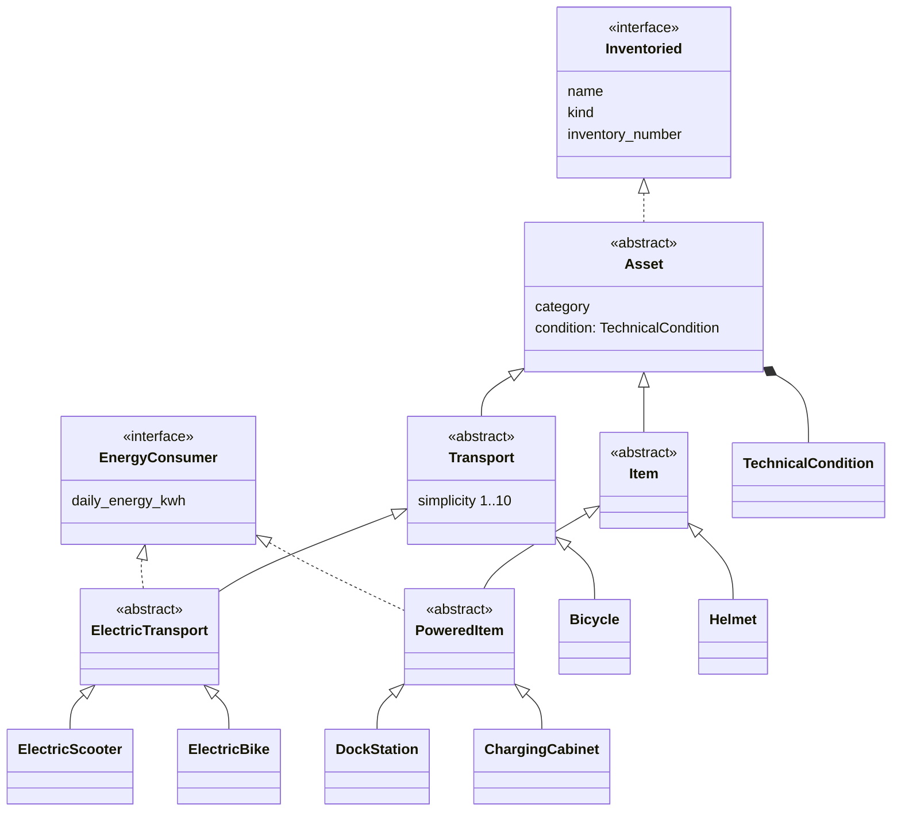
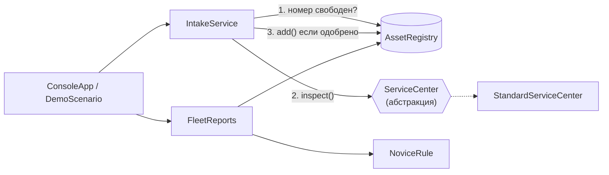

# ВышКат — учёт парка кикшеринга ВШЭ

> «Доедем до дедлайна». КПО, домашнее задание №1: SOLID · DI-контейнер · юнит-тесты.

Консольное приложение учёта парка «ВышКат»: приём техники и вещей через техосмотр, отчёт по числу единиц и суточному энергопотреблению, список техники для новичков, инвентарная ведомость.

**Стек:** Python ≥ 3.11 · DI-контейнер [`dependency-injector`](https://python-dependency-injector.ets-labs.org/) · `rich` (вывод в консоль) · `pytest` + `pytest-cov` · `ruff` (стиль).

**Итог проверки:** 125 тестов, покрытие **100%** (строки и ветви), `ruff check` без замечаний. Проверено на Python 3.11, 3.12 и 3.14.

---

## Содержание

1. [Запуск](#1-запуск)
2. [Что умеет: функциональные требования → код](#2-что-умеет-функциональные-требования--код)
3. [Архитектура](#3-архитектура)
4. [Логика ключевых решений](#4-логика-ключевых-решений)
5. [SOLID: где и зачем](#5-solid-где-и-зачем)
6. [DI-контейнер](#6-di-контейнер)
7. [Обязательные вопросы](#7-обязательные-вопросы)
8. [Тесты](#8-тесты)
9. [Чего сознательно нет](#9-чего-сознательно-нет)
10. [Роль ИИ](#10-роль-ии)

---

## 1. Запуск

```bash
cd SD1
python3 -m venv .venv
source .venv/bin/activate            # Windows: .venv\Scripts\activate
pip install -e ".[dev]"
```

| Команда | Что делает |
|---|---|
| `python -m vyshkat --demo` | **демо без ввода**: все сценарии подряд на пустом парке |
| `python -m vyshkat` | интерактивное меню (стартует с пилотным парком: «самокатов пока три») |
| `pytest` | все тесты |
| `pytest --cov` | тесты + отчёт о покрытии |
| `ruff check . && ruff format --check .` | проверка стиля кода |

С [uv](https://docs.astral.sh/uv/) можно так: `uv venv && uv pip install -e ".[dev]"`.

Меню интерактивного режима:

```
╭─ Меню ─────────────────────────────────────────────╮
│  1  Принять транспорт (техосмотр → баланс)         │
│  2  Поставить вещь на баланс (техосмотр → баланс)  │
│  3  Отчёт: число единиц и энергопотребление        │
│  4  Техника для новичков                           │
│  5  Инвентарная ведомость                          │
│  6  Демо-сценарий (на отдельном пустом парке)      │
│  0  Выход                                          │
╰────────────────────────────────────────────────────╯
```

Некорректный ввод (буквы вместо числа, «простота» 11, пустое наименование) переспрашивается. Инвентарный номер проверяется **сразу после ввода**: формат и занятость, чтобы не заполнять форму зря. При выборе вида есть пункт «0 — назад». `Ctrl+D` / `Ctrl+C` завершают программу штатно.

## 2. Что умеет: функциональные требования → код

| # | Требование ТЗ | Где в коде | Где увидеть в демо |
|---|---|---|---|
| 1 | Добавление транспорта в парк | [`IntakeService.receive`](src/vyshkat/services/intake.py), меню «1» | шаг 1 |
| 2 | Перед приёмкой — техосмотр (принять / отклонить) | [`ServiceCenter` / `StandardServiceCenter`](src/vyshkat/services/service_center.py) | шаги 1–2 |
| 3 | Суммарное суточное потребление энергии | [`FleetReports.summary`, `total_daily_energy_kwh`](src/vyshkat/services/reports.py) | шаг 5 |
| 4 | Список для новичков (простота ≥ 6, правило усложнено) | [`NoviceRule`](src/vyshkat/services/novice_rule.py), [`FleetReports.novice_assessments`](src/vyshkat/services/reports.py) | шаг 6 |
| 5 | Вещи на балансе, инвентарные номера вместе с техникой | [`domain/items.py`](src/vyshkat/domain/items.py), [`FleetReports.inventory`](src/vyshkat/services/reports.py) | шаги 4, 7 |
| 6 | Демонстрация всех сценариев | [`DemoScenario`](src/vyshkat/cli/demo.py), `python -m vyshkat --demo` | всё демо |

Дополнительно демо показывает, как система защищается от ошибок учёта: дубликат инвентарного номера и некорректная «простота» (шаг 3).

## 3. Архитектура

```
src/vyshkat/
├── domain/            модель предметной области, не зависит ни от чего внешнего
│   ├── contracts.py   интерфейсы Inventoried, EnergyConsumer
│   ├── assets.py      Asset (всё на балансе) + TechnicalCondition (состояние при приёмке)
│   ├── transport.py   Transport → Bicycle, ElectricTransport → ElectricScooter, ElectricBike
│   ├── items.py       Item → Helmet, PoweredItem → DockStation, ChargingCabinet
│   └── errors.py      DomainError, DuplicateInventoryNumberError
├── services/          прикладная логика, зависит только от domain
│   ├── service_center.py  ServiceCenter (абстракция) + StandardServiceCenter + InspectionResult
│   ├── intake.py          IntakeService — приёмка на баланс
│   ├── registry.py        AssetRegistry — хранение и уникальность номеров
│   ├── novice_rule.py     NoviceRule — допуск техники к новичкам
│   └── reports.py         FleetReports — сводка, энергия, новички, ведомость
├── cli/               консоль: ввод (Prompter), вывод (FleetView), меню (ConsoleApp), демо
├── catalog.py         перечень видов, доступных для приёмки через консоль
├── container.py       DI-контейнер (composition root)
└── __main__.py        точка входа
```

Зависимости направлены внутрь: `cli → services → domain`. Домен не знает о консоли, DI и хранилище.

### Доменная модель



### Сервисы и поток приёмки



## 4. Логика ключевых решений

**Всё, что ставится на баланс, проходит приёмку.** Заказчик: «техника попадает в активный парк только после техосмотра». Вещи (док-станции, шкафы, шлемы) тоже устройства, поэтому идут через тот же `IntakeService`: шлем с трещиной на баланс не ставим. Путь приёмки один, особых случаев нет.

**«Способности» выражены интерфейсами, а не флагами.** У велосипеда и шлема нет `daily_energy_kwh = 0`: они просто не реализуют `EnergyConsumer`. Отчёт по энергии суммирует только тех, кто действительно потребляет (`isinstance(asset, EnergyConsumer)`). Вариант «0 у всех» формально работал бы, но смешивал два разных смысла: «не потребляет» и «потребляет ноль».

**Техосмотру нужны данные, поэтому у объекта есть состояние при приёмке.** [`TechnicalCondition`](src/vyshkat/domain/assets.py) хранит процент износа и список дефектов. `StandardServiceCenter` отклоняет объект, если есть дефекты или износ > 30%, и возвращает **все** причины сразу (`InspectionResult`).

**Правило для новичков усложнено, но в меру.** База из ТЗ — «простота» ≥ 6. Добавлено: износ ≤ 20%, чтобы новичку не доставалась «уставшая» техника («какие устройства можно *безопасно* выдавать новичкам»). Правило объясняет отказ («простота 5 < 6», «износ 25% > 20%»), и отчёт это показывает. Пороги задаются в контейнере.

**Инвентарные номера обязательны и уникальны.** Номер нормализуется (`vk-ts-001` → `VK-TS-001`), проверяется формат (буквы, цифры, дефис), а дубликат отклоняется ещё **до** техосмотра: осматривать объект с чужим номером бессмысленно. Правила номера вынесены в функцию [`normalize_inventory_number`](src/vyshkat/domain/assets.py): её использует и `Asset`, и консоль, которая проверяет номер сразу после ввода (плюс `IntakeService.ensure_number_is_free`).

**Инварианты проверяются в конструкторах.** Объект с «простотой» 11 (или 6.5), отрицательным или бесконечным расходом просто не создаётся (`DomainError`). Поэтому сервисы работают только с корректными объектами и не проверяют их повторно.

**Консоль спрашивает поля по интерфейсам вида.** Если выбранный вид — `Transport`, спрашивается «простота», если `EnergyConsumer` — расход. Поэтому новый вид транспорта не требует правок в консоли.

**«Простота для новичка» есть только у транспорта.** В ТЗ сказано «у устройств есть характеристика», но выдают новичкам только прокатную технику («список *прокатной* техники, которая подходит для новичков»). Простота у зарядного шкафа ничего бы не значила, поэтому поле живёт в `Transport`.

**Зачем класс на каждый вид, если `ElectricScooter` и `ElectricBike` отличаются только названием?** Поведение (расход энергии, простота) живёт в промежуточных классах `ElectricTransport` и `PoweredItem`, а конечные классы дают **номинальный тип** вида. Благодаря этому консоль выбирает вид из каталога и решает, какие поля спрашивать, по `issubclass`, а новый вид добавляется без правок существующего кода. Хранить вид строкой в поле было бы короче, но тогда пришлось бы проверять «электрический ли он» через флаги, а не через интерфейсы.

## 5. SOLID: где и зачем

**S — единственная ответственность.** У каждого класса одна причина для изменения:

| Класс | Меняется, когда меняется… |
|---|---|
| `StandardServiceCenter` | политика техосмотра |
| `IntakeService` | порядок приёмки (номер → осмотр → баланс) |
| `AssetRegistry` | способ хранения |
| `NoviceRule` | правило допуска новичков |
| `FleetReports` | состав и расчёт отчётов |
| `FleetView` | внешний вид вывода |
| `Prompter` | разбор ввода |
| `ConsoleApp` | навигация по меню |

Пример: чтобы изменить оформление таблиц, правится только `FleetView`. Чтобы изменить порог износа, правится одна строка в `container.py`.

**O — открытость для расширения.** Новый вид транспорта или вещи — это новый класс, его экспорт в `domain/__init__.py` и строка в [`catalog.py`](src/vyshkat/catalog.py). Отчёты группируют по `kind` и `category`, которые объект сообщает сам, поэтому списков видов в них нет. Новая политика техосмотра — новая реализация `ServiceCenter` и строка в контейнере, `IntakeService` не меняется.

**L — подстановка Лисков.** Любой подкласс `Asset` подставляется туда, где ожидается `Asset`: в реестр, приёмку, отчёты и ведомость. Тест [`test_every_catalog_kind_goes_all_the_way_to_the_reports`](tests/test_catalog.py) проверяет это по-настоящему: **каждый** вид из каталога проходит консольную форму, техосмотр, реестр, сводку, энергию и ведомость. Велосипед не притворяется потребителем энергии, поэтому не нарушает контракт `EnergyConsumer`. Фейковый техосмотр в тестах подставляется вместо реального без изменения поведения `IntakeService`.

**I — разделение интерфейсов.** `Inventoried` (наименование, вид, номер) и `EnergyConsumer` (расход) разделены. Инвентарная ведомость ([`FleetView.inventory`](src/vyshkat/cli/view.py)) принимает `Sequence[Inventoried]` и не знает про энергию. Отчёт по энергии видит только `EnergyConsumer`. Шлем не обязан реализовывать `daily_energy_kwh`.

**D — инверсия зависимостей.** [`IntakeService`](src/vyshkat/services/intake.py) зависит от абстракции `ServiceCenter`, а не от `StandardServiceCenter`. Конкретные реализации выбираются только в [`container.py`](src/vyshkat/container.py). Никто, кроме контейнера, не создаёт сервисы через `new`. Консоль тоже получает зависимости снаружи (`Prompter`, `FleetView`, `Console`), поэтому тестируется на заготовленном вводе.

## 6. DI-контейнер

[`container.py`](src/vyshkat/container.py) — единственное место, где собирается приложение:

```python
class Container(containers.DeclarativeContainer):
    registry = providers.Singleton(AssetRegistry)
    service_center = providers.Singleton(StandardServiceCenter, max_wear_percent=30)
    novice_rule = providers.Singleton(NoviceRule, min_simplicity=6, max_wear_percent=20)
    intake = providers.Singleton(IntakeService, registry=registry, service_center=service_center)
    reports = providers.Singleton(FleetReports, registry=registry, novice_rule=novice_rule)
    ...
```

- `Singleton` — один экземпляр на контейнер: приёмка и отчёты видят **один** реестр.
- `override` нужно делать **до** первого `container.intake()`: `intake` — синглтон и держит ту зависимость, которую получил при создании. Поэтому в тестах сначала подмена, потом получение сервиса.
- Каждый тест получает свежий `Container()` ([`conftest.py`](tests/conftest.py)) и работает со своим пустым парком.
- Демо из меню запускается на отдельном `Container()`, поэтому не смешивается с рабочим парком.

**Подмена техосмотра в тестах** ([`tests/test_intake.py`](tests/test_intake.py)):

```python
container.service_center.override(FakeServiceCenter(InspectionResult.reject("Люфт руля")))
result = container.intake().receive(scooter())  # IntakeService получил фейк через DI
assert not result.approved and len(container.registry()) == 0
```

Используются оба вида двойников: собственный stub+spy [`FakeServiceCenter`](tests/fakes.py) (задаёт решение и запоминает, кого осматривал) и `unittest.mock.create_autospec(ServiceCenter)`.

## 7. Обязательные вопросы

### Какой принцип SOLID применён наиболее явно и где?

**DIP — вокруг техосмотра.** [`IntakeService`](src/vyshkat/services/intake.py) зависит от абстракции [`ServiceCenter`](src/vyshkat/services/service_center.py). Какую политику использовать, решает только [`Container`](src/vyshkat/container.py), а тесты подменяют её одной строкой `override`. Именно это позволило проверить приёмку отдельно от правил осмотра. Второй по заметности принцип — ISP: интерфейсы-«способности» `Inventoried` и `EnergyConsumer` в [`contracts.py`](src/vyshkat/domain/contracts.py).

### Какой принцип сознательно ограничен / «почти нарушен» и почему это приемлемо?

**DIP ограничен для `AssetRegistry` и `NoviceRule`.** `IntakeService` и `FleetReports` зависят от этих **конкретных** классов, интерфейсов у них нет. Причина: реализация сейчас одна (хранилище в памяти, одно правило). Интерфейс «на всякий случай» был бы тем самым декоративным SOLID. Риск небольшой: оба класса внедряются через контейнер, поэтому когда появится БД, абстракция выделяется в одном месте, а в контейнере меняется одна строка.

Второе осознанное упрощение касается **OCP в консольной форме** ([`ConsoleApp._ask_asset`](src/vyshkat/cli/app.py)). Форма опирается на соглашение об именах параметров конструктора (`simplicity`, `daily_energy_kwh`); соблюдение этого соглашения для всех видов каталога проверяет [`tests/test_catalog.py`](tests/test_catalog.py). Вид с новым обязательным полем (например, «максимальная скорость») потребует добавить в форму вопрос. Универсальный движок форм ради гипотетического поля — это overengineering.

### Что сломается (или не сломается) при расширении?

| Расширение | Что меняем | Что НЕ меняется |
|---|---|---|
| Новый вид транспорта (моноколесо) | класс `Monowheel(ElectricTransport)`, экспорт в `domain/__init__.py`, строка в `catalog.py` | приёмка, техосмотр, отчёты, консоль, контейнер |
| Новый вид вещи (велозамок) | класс `BikeLock(Item)`, экспорт, строка в `catalog.py` | всё остальное |
| Склад запчастей | `SparePart(Asset)` с `category = "Запчасти"`, виды запчастей, пункт меню в конце списка | отчёты (сводка считает любые категории через `units_by_category`), ведомость, приёмка |
| Сотрудники службы эксплуатации | отдельный модуль `staff/`; `Employee` **не** наследует `Asset` и `Inventoried` (по ТЗ сотрудники не на балансе) | учёт парка не затрагивается вообще |
| Хранение в БД или файле | выделить протокол `AssetRepository` из `AssetRegistry`, новая реализация, 1 строка в контейнере; в `IntakeService` и `FleetReports` меняется только аннотация типа | логика сервисов, домен, консоль |
| Новая политика техосмотра | новый `ServiceCenter` (можно обёрткой над стандартным), 1 строка в контейнере | `IntakeService`, тесты приёмки |

Ничего не сломается от **нового вида**: отчёты группируют по `kind` и `category`, которые объект сообщает сам, а [`tests/test_catalog.py`](tests/test_catalog.py) автоматически прогонит новый вид через форму, приёмку и отчёты.

### Какой тест фиксирует решение техосмотра и правило «для новичков»? Как подменяется зависимость?

- **Техосмотр, реальная политика:** [`tests/test_service_center.py`](tests/test_service_center.py). Граница износа 30% (включительно) и 31% (отказ), каждый дефект становится причиной, все причины выдаются сразу.
- **Техосмотр внутри приёмки с подменой через DI:** [`tests/test_intake.py`](tests/test_intake.py):
  - `test_device_rejected_by_service_center_stays_off_balance` — фейк отклоняет, объекта нет на балансе;
  - `test_every_new_device_goes_through_inspection` — spy видит каждый объект;
  - `test_duplicate_number_is_refused_before_inspection` — дубликат до осмотра не доходит;
  - `test_service_center_can_be_replaced_with_a_mock` — `create_autospec`.

  Подмена: `container.service_center.override(fake)`. `IntakeService` получает фейк, ничего о нём не зная.
- **Правило для новичков:** [`tests/test_novice_rule.py`](tests/test_novice_rule.py). Граница простоты 5 → нет, 6 → да; граница износа 20 → да, 21 → нет; текст причин. [`tests/test_reports.py::TestNovices`](tests/test_reports.py) проверяет, что в список попадает только подходящий транспорт, а вещи не попадают.

### Что сделал ИИ, а что изменили вы?

См. раздел [10. Роль ИИ](#10-роль-ии).

## 8. Тесты

```bash
pytest --cov
```

| Файл | Что фиксирует |
|---|---|
| `test_domain.py` | инварианты (простота — целое 1–10, энергия конечная и > 0, формат номера), какие виды реализуют `EnergyConsumer`, абстрактность `Transport` |
| `test_catalog.py` | каждый вид каталога проходит весь путь «форма → техосмотр → баланс → отчёты» (LSP/OCP) |
| `test_service_center.py` | решения реального техосмотра и их причины |
| `test_intake.py` | приёмку с подменой техосмотра через DI (fake, spy, mock) |
| `test_registry.py` | уникальность номеров, порядок, защиту от внешней мутации |
| `test_novice_rule.py` | правило новичков на граничных значениях |
| `test_reports.py` | число единиц, энергию, список новичков, ведомость |
| `test_container.py` | сборку контейнера: общий реестр, синглтоны, временный `override` |
| `test_prompter.py` | переспрос при некорректном вводе, запятую в дробях |
| `test_console_app.py` | сценарии меню на заготовленном вводе: приём, отказ, немедленный переспрос неверного или занятого номера, «назад» |
| `test_demo_and_main.py` | демо и точку входа (`--demo` и интерактивный режим) |

Тесты проверяют **поведение** (что оказалось на балансе, что выведено пользователю), а не внутренние вызовы. Исключение — spy и mock в `test_intake.py`, где сам вызов техосмотра и есть проверяемое требование.

## 9. Чего сознательно нет

Критерий ТЗ: «за мёртвый SOLID и overengineering снизим оценку». Поэтому **не** делали:

- интерфейсы для `AssetRegistry` и `NoviceRule`: реализация одна (см. «почти нарушен»);
- фабрику на каждый вид: каталог из классов и проверка интерфейсов в форме дают то же проще;
- слой хранения в файле или БД: в ТЗ его нет;
- событийную шину, слой DTO с мапперами, универсальный движок форм.

## 10. Роль ИИ

**Как использовался ИИ** (ассистент Claude):

- работал как ассистент при написании кода по согласованной архитектуре: предлагал реализацию классов и методов, сигнатуры и аргументы функций, варианты тестов;
- помогал с проверками: прогон тестов на Python 3.11, 3.12 и 3.14, покрытие, `ruff`;
- помогал оформить README.

**Что решил и сделал я:**

- выбрал стек (Python, `dependency-injector`, `rich`, `pytest`) и формат консоли: интерактивное меню плюс авто-демо без ввода;
- архитектуру обсуждали и согласовывали до начала реализации, итоговые решения за мной:
  - иерархия предметной области: `Asset` → `Transport` / `Item` → конкретные виды, промежуточные уровни абстрактные;
  - «способности» через интерфейсы `Inventoried` и `EnergyConsumer`, а не через флаги и `daily_energy_kwh = 0`;
  - единый путь приёмки: всё, что ставится на баланс, проходит техосмотр через `IntakeService`;
  - техосмотр за абстракцией `ServiceCenter`, конкретная политика и пороги выбираются только в DI-контейнере;
  - сознательные упрощения: без интерфейсов для `AssetRegistry` и `NoviceRule`, без слоя хранения и универсального движка форм (см. раздел 9);
- разделил консоль на ввод (`Prompter`), вывод (`FleetView`) и меню (`ConsoleApp`), чтобы её можно было тестировать на заготовленном вводе;
- проверил работу вручную: меню, демо-режим, отказы техосмотра, повторный и неверный инвентарный номер;
- разобрал каждый принцип SOLID в проекте и ответы на обязательные вопросы (раздел 7).
