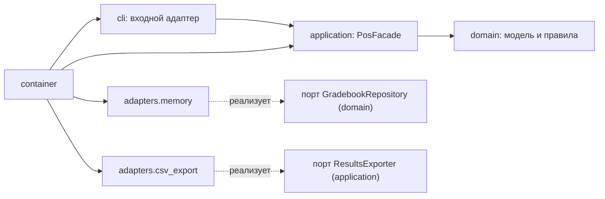
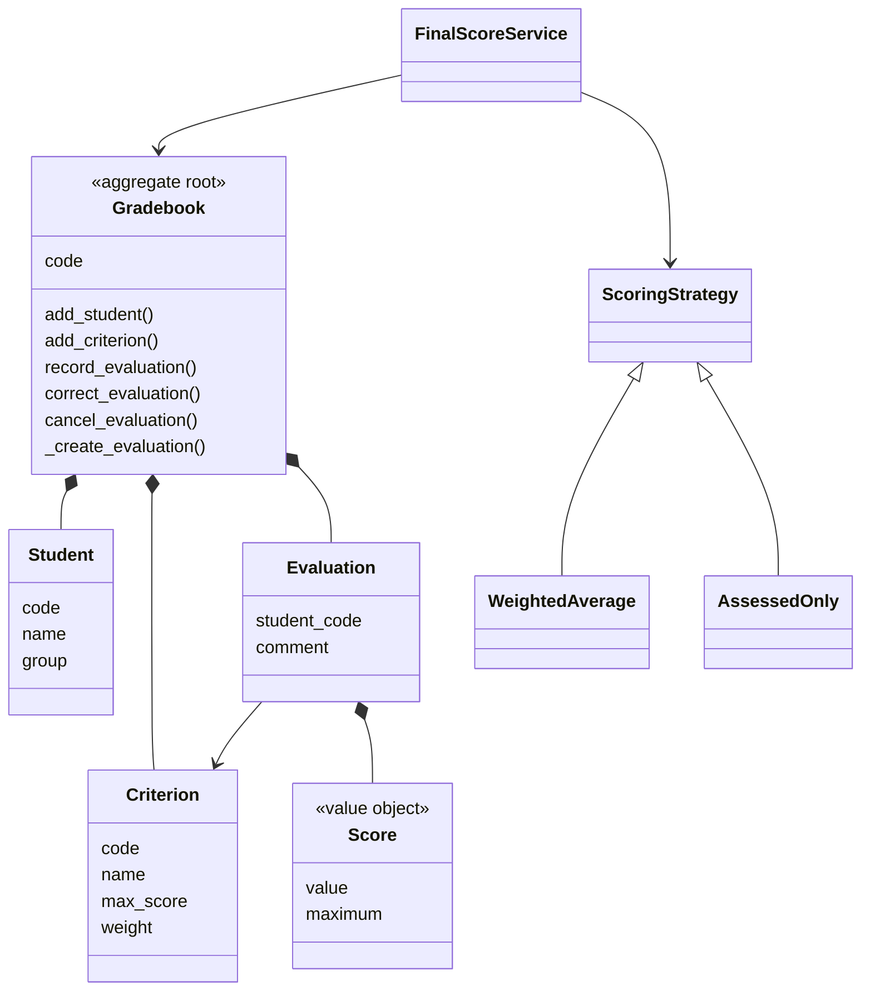

# ПОС — преподавательская оценка студентов

> «Обратная связь — спорт для двоих». КПО, домашнее задание №2: DDD · архитектура · паттерны GoF.

Консольный модуль для одного курса: студенты, рубрикатор, выставление, исправление и отмена оценок, итог по весам, аналитика и выгрузка итогов в CSV.

**Стек:** Python ≥ 3.11 · DI-контейнер [`dependency-injector`](https://python-dependency-injector.ets-labs.org/) · `rich` (вывод в консоль) · `pytest` + `pytest-cov` · `ruff` (стиль). Домен использует только стандартную библиотеку.

**Итог проверки:** 143 теста, покрытие **100%** (строки и ветви), `ruff check` без замечаний. Проверено на Python 3.11, 3.12 и 3.14.

---

## Содержание

1. [Запуск](#1-запуск)
2. [Что умеет: функциональные требования → код](#2-что-умеет-функциональные-требования--код)
3. [Архитектура](#3-архитектура)
4. [Карта DDD](#4-карта-ddd)
5. [Логика ключевых решений](#5-логика-ключевых-решений)
6. [Паттерны GoF: где и зачем](#6-паттерны-gof-где-и-зачем)
7. [DI-контейнер](#7-di-контейнер)
8. [Тесты](#8-тесты)
9. [Расширение и чего сознательно нет](#9-расширение-и-чего-сознательно-нет)
10. [Роль ИИ](#10-роль-ии)

---

## 1. Запуск

```bash
cd SD2
python3 -m venv .venv
source .venv/bin/activate            # Windows: .venv\Scripts\activate
pip install -e ".[dev]"
```

| Команда | Что делает |
|---|---|
| `python -m pos --demo` | **демо без ввода**: весь сценарий подряд, CSV в `exports/demo-results.csv` |
| `python -m pos` | интерактивное меню, ведомость изначально пустая |
| `python -m pos --policy assessed` | предварительный итог: только по выставленным оценкам |
| `python -m pos --export путь.csv` | свой путь выгрузки (существующий файл перезаписывается) |
| `pytest` | все тесты |
| `pytest --cov` | тесты + отчёт о покрытии |
| `ruff check . && ruff format --check .` | проверка стиля кода |

С [uv](https://docs.astral.sh/uv/) можно так: `uv venv && uv pip install -e ".[dev]"`.

Меню интерактивного режима:

```
╭────────────────── Меню ───────────────────╮
│  1   Добавить студента                    │
│  2   Список студентов                     │
│  3   Добавить критерий                    │
│  4   Рубрикатор                           │
│  5   Выставить оценку                     │
│  6   Оценки студента                      │
│  7   Исправить оценку                     │
│  8   Отменить оценку                      │
│  9   Итоги по студентам                   │
│  10  Аналитика курса                      │
│  11  Экспорт итогов в CSV                 │
│  12  Демо (в отдельной пустой ведомости)  │
│  0   Выход                                │
╰───────────────────────────────────────────╯
```

Студент и критерий выбираются из списка, есть пункт «0 — назад». Некорректный ввод (буквы вместо числа, балл 12 из 10, занятый код) переспрашивается, дробь можно ввести через запятую. `Ctrl+D` / `Ctrl+C` завершают программу штатно.

Данные живут в памяти до выхода, как в ДЗ №1. CSV — снимок итогов, а не резервная копия ведомости.

## 2. Что умеет: функциональные требования → код

| # | Требование ТЗ | Где в коде | Где увидеть в демо |
|---|---|---|---|
| 1 | Студенты и рубрикатор: добавить и посмотреть | [`Gradebook.add_student`, `add_criterion`](src/pos/domain/model.py), меню 1–4 | шаг 1 |
| 2 | Выставить, посмотреть, исправить, отменить оценку | [`Gradebook.record_evaluation`, `correct_evaluation`, `cancel_evaluation`](src/pos/domain/model.py), меню 5–8 | шаги 2, 4 |
| 3 | Балл в диапазоне критерия | [`Score`](src/pos/domain/values.py) | шаг 3 |
| 3 | Оценка только по критерию из рубрикатора | [`Gradebook._create_evaluation`](src/pos/domain/model.py) | шаг 3 |
| 3 | Итог согласован с оценками (Domain Service) | [`FinalScoreService`](src/pos/domain/scoring.py), меню 9 | шаги 2, 4 |
| 4 | Сквозная демонстрация с экспортом | [`DemoScenario`](src/pos/cli/demo.py), `python -m pos --demo` | всё демо |

Дополнительно: аналитика курса (меню 10) и выгрузка CSV через порт (меню 11). Изменение и удаление студентов и критериев ТЗ называет необязательными, поэтому их нет.

## 3. Архитектура

Выбрана **Ports and Adapters (Hexagonal)**.

```
src/pos/
├── domain/            модель и правила, не зависит ни от чего внешнего
│   ├── values.py      Score + проверки чисел, текста и кодов
│   ├── model.py       Student, Criterion, Evaluation, Gradebook (корень агрегата и фабрика оценок)
│   ├── scoring.py     FinalScoreService + стратегии расчёта, FinalScore
│   ├── ports.py       порт GradebookRepository
│   └── errors.py      DomainError, DuplicateError, NotFoundError
├── application/       сценарии, зависят только от domain
│   ├── facade.py      PosFacade — все сценарии для консоли и демо
│   ├── reports.py     StudentResult, CourseStatistics
│   └── ports.py       порт ResultsExporter
├── adapters/          реализации портов
│   ├── memory.py      InMemoryGradebookRepository
│   └── csv_export.py  CsvResultsExporter
├── cli/               консоль: ввод (Prompter), вывод (PosView), меню (ConsoleApp), демо
├── container.py       DI-контейнер (composition root)
└── __main__.py        точка входа и аргументы
```

Зависимости направлены внутрь: `cli → application → domain`, адаптеры зависят от портов. Домен не знает о консоли, CSV, файлах и DI. Стрелки ниже — зависимости кода, а не порядок вызовов:



Границы слоёв проверяет тест [`test_architecture.py`](tests/test_architecture.py): он разбирает импорты и падает, если домен импортирует, например, `csv` или `application`.

## 4. Карта DDD

**Единый язык.** Студент — `Student`, критерий — `Criterion`, оценка — `Evaluation`, рубрикатор — `Gradebook.criteria`, ведомость — `Gradebook`, итог — `FinalScore`. Те же слова в меню, сценариях и тестах.

| Понятие DDD | Где | Почему так |
|---|---|---|
| Entity | `Student`, `Criterion` | Идентичность — код. Другое имя не делает студента другим |
| Entity | `Evaluation` | Идентичность — пара «студент, критерий». Исправление меняет балл этой же оценки |
| Value Object | `Score(value, maximum)` | Сравнивается по значению и шкале, неизменяем. `8/10` равно `8.0/10.0`, но не равно `8/100` |
| Value Object | `FinalScore` | Вычисленный итог: значение, полнота, название правила |
| Aggregate Root | `Gradebook` | Владеет студентами, рубрикатором и оценками одного курса |
| Repository (порт) | `GradebookRepository` | Загружает и сохраняет агрегат целиком; реализация в `adapters` |
| Domain Service | `FinalScoreService` | Итог зависит от оценок, рубрикатора и правила, а не от одной сущности |



**Граница агрегата — весь курс.** Изменения идут только через `Gradebook`, поэтому оценку для отсутствующего студента или критерия сохранить нельзя. Сценарий всегда такой: загрузить ведомость → вызвать действие домена → сохранить, только если действие прошло.

**Инварианты охраняет модель, а не консоль:**

- код обязателен, приводится к верхнему регистру и уникален; имя не пустое;
- максимум и вес критерия — числа больше нуля;
- балл — от 0 до максимума критерия включительно;
- оценка создаётся только по студенту и критерию этой ведомости;
- одна пара «студент — критерий» имеет одну оценку; повторно выставить нельзя, только исправить;
- нельзя исправить или отменить несуществующую оценку; неудачная операция ничего не меняет;
- итог лежит в шкале 0–10.

Модель не анемичная: `Gradebook` сам проверяет правила при каждом изменении, а `Criterion`, `Score` и `Evaluation` нельзя создать некорректными.

## 5. Логика ключевых решений

**Формула итога.** ТЗ просит итог по весам, но не задаёт шкалу. Принято:

```text
итог из 10 = 10 × Σ(балл_i / максимум_i × вес_i) / Σ(вес_i)
```

Суммы берутся по всему рубрикатору. Пропуск даёт ноль, а выставленный ноль считается оценкой. Веса `30/70` и `0.3/0.7` равносильны, сумма весов не обязана быть 1. Пример: `9/10` с весом 30 и `16/20` с весом 70 дают `8.30`.

**Предварительный режим — вторая стратегия.** `--policy assessed` считает только по выставленным оценкам: одна оценка `9/10` даёт `9.00`, а основной режим при весе 30 из 100 — `2.70`. Название режима видно в начале работы и в CSV.

**Итог не хранится.** Каждый запрос пересчитывает его из текущих оценок. После исправления, отмены или нового критерия итог сразу верный, кэш сбрасывать не нужно.

**Точные числа.** Ввод хранится в `Decimal`, расчёт идёт в точных дробях `Fraction`, округление — один раз в конце, до сотых, половина вверх. `float` не принимается, чтобы не было двоичной погрешности. Число должно быть от `1e-9` до `1e9` по модулю: так запись `1e999999999` не повесит программу.

**Аналитика.** Число студентов, критериев и оценок, сколько студентов оценено полностью, средний, минимальный и максимальный итог. Без студентов среднего нет, а не «0».

**CSV — внешний адаптер.** UTF-8 с BOM и разделитель `;`, чтобы файл открывался в Excel. Сначала файл пишется во временный, потом заменяет старый: при ошибке прежний CSV не портится.

**Исправление оценки сохраняет комментарий.** Если при исправлении нажать Enter, старый комментарий остаётся.

## 6. Паттерны GoF: где и зачем

По одному паттерну из каждой группы, как просит ТЗ.

| Группа | Паттерн и место | Какую боль закрывает |
|---|---|---|
| Порождающий | **Фабрика**, [`Gradebook._create_evaluation`](src/pos/domain/model.py) | Единая точка создания оценки. Берёт студента и критерий **только из этой ведомости** и строит `Score` в шкале критерия. Выставление и исправление идут через неё, поэтому оценку «по чужому критерию» или 12 из 10 создать нельзя |
| Структурный | **Facade**, [`PosFacade`](src/pos/application/facade.py) | Консоль и демо вызывают готовые сценарии и не управляют репозиторием, расчётом и экспортом сами. Логика не размазана по UI |
| Поведенческий | **Strategy**, [`ScoringStrategy`](src/pos/domain/scoring.py): `WeightedAverage`, `AssessedOnly` | Правило итога меняется флагом `--policy` без правок модели, сценариев и CSV |

**Почему фабрика — метод агрегата, а не отдельный класс.** Для проверки «критерий из рубрикатора» фабрике нужен сам рубрикатор, а он внутри `Gradebook`. Отдельный класс `EvaluationFactory` пришлось бы снабжать тем же рубрикатором, то есть дублировать агрегат.

## 7. DI-контейнер

[`container.py`](src/pos/container.py) — единственное место, где выбираются реализации:

```python
class Container(containers.DeclarativeContainer):
    config = providers.Configuration(default={"policy": "weighted"})
    repository = providers.Singleton(InMemoryGradebookRepository, initial=initial_gradebook)
    scoring_strategy = providers.Selector(
        config.policy,
        weighted=providers.Singleton(WeightedAverage),
        assessed=providers.Singleton(AssessedOnly),
    )
    scores = providers.Singleton(FinalScoreService, strategy=scoring_strategy)
    exporter = providers.Singleton(CsvResultsExporter)
    facade = providers.Singleton(PosFacade, repository=repository, scores=scores, exporter=exporter)
    ...
```

- `Singleton` — один экземпляр на контейнер: все сценарии видят **одну** ведомость.
- `Selector` выбирает стратегию по `--policy`, режим задаётся до сборки графа.
- Демо из меню запускается на новом `Container()`, поэтому демо-оценки не попадают в рабочую ведомость.
- `override` делается **до** первого `container.facade()` или вместе с `reset()`: синглтон держит ту зависимость, которую получил при создании.
- Каждый тест получает свежий контейнер ([`conftest.py`](tests/conftest.py)).

**Подмена в тестах** ([`test_application.py`](tests/test_application.py), [`test_scoring.py`](tests/test_scoring.py)):

```python
with container.exporter.override(exporter):
    container.facade.reset()  # фасад — синглтон, пересобираем его с фейком
    assert container.facade().export("target") == 2
assert exporter.results[0].final.value == Decimal("1.50")
```

## 8. Тесты

```bash
pytest --cov
```

| Файл | Что фиксирует |
|---|---|
| `test_domain.py` | инварианты: диапазон балла, коды, дубликаты, критерий из рубрикатора, фабрику, Entity против VO |
| `test_scoring.py` | формулу: разные шкалы и веса, пропуски и нули, обе стратегии, пересчёт, округление |
| `test_application.py` | сценарии фасада: сохранение только после успеха, статистику, подмену через DI |
| `test_reliability.py` | ошибку сохранения и повтор, один снимок на отчёт, отказ от `float` и огромных чисел |
| `test_csv_export.py` | CSV читается обратно, кавычки и переносы, старый файл цел при сбое записи |
| `test_console_app.py` | меню на заготовленном вводе: полный сценарий, переспрос, «назад», комментарий при исправлении |
| `test_demo_and_main.py` | демо, обе стратегии, точку входа, выход по `Ctrl+D` / `Ctrl+C` |
| `test_architecture.py` | направление зависимостей между слоями |

Тесты проверяют **поведение**: что лежит в ведомости, какой итог посчитан, что записано в CSV, что увидел пользователь.

## 9. Расширение и чего сознательно нет

| Расширение | Что меняем | Что НЕ меняется |
|---|---|---|
| Новое правило итога (например, без худшей оценки) | класс `ScoringStrategy` + строка в `Selector` | модель, фасад, консоль, CSV |
| Хранение в JSON-файле | новый адаптер `GradebookRepository`, 1 строка в контейнере | домен, фасад, консоль |
| Экспорт в JSON | новый адаптер `ResultsExporter`, 1 строка в контейнере | домен, фасад |
| Импорт ведомости | новый входной порт и адаптер; здесь уместен Template Method (общий каркас, разный парсинг) | домен и его инварианты |
| Пересдачи и апелляции | новые сущности внутри `Gradebook` или отдельный агрегат | расчёт итога через стратегию |

Критерий ТЗ: «за мёртвую архитектуру из пустых папок и overengineering оценку снизим». Поэтому **не** делали:

- БД, ORM, шину команд, event sourcing;
- Unit of Work и отдельный обработчик на каждую команду: в однопользовательской консоли фасада хватает;
- изменение и удаление студентов и критериев: в ТЗ «по необходимости»;
- второй паттерн в группе ради количества.

## 10. Роль ИИ

**Как использовался ИИ** (ассистент Claude):

- писал код по моим инструкциям и по моей архитектуре: реализовывал нужные мне классы и функции, переписывал их по моим замечаниям, предлагал варианты тестов;
- прогонял проверки: тесты на Python 3.11, 3.12 и 3.14, покрытие, `ruff`;
- помогал оформить README.

**Что решил и сделал я:**

- сохранил формат ДЗ №1: тот же стек, меню плюс авто-демо, DI-контейнер, тесты;
- спроектировал архитектуру до начала реализации, итоговые решения за мной:
  - Ports and Adapters: порт хранения в домене, порт экспорта в сценариях, адаптеры снаружи;
  - один агрегат на курс `Gradebook` и фабрика оценок внутри него;
  - формула итога, трактовка пропусков и второй режим через Strategy;
  - сознательные упрощения из раздела 9;
- проверил работу вручную: меню, демо, оба режима, неверный балл, чужой критерий, экспорт CSV.
