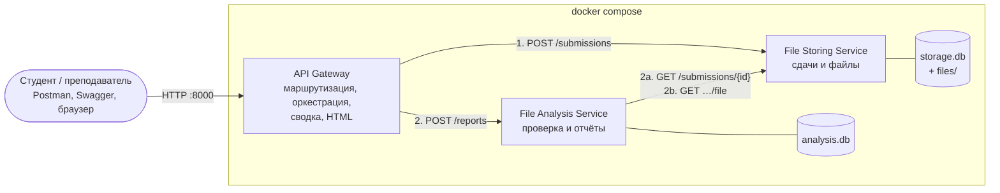
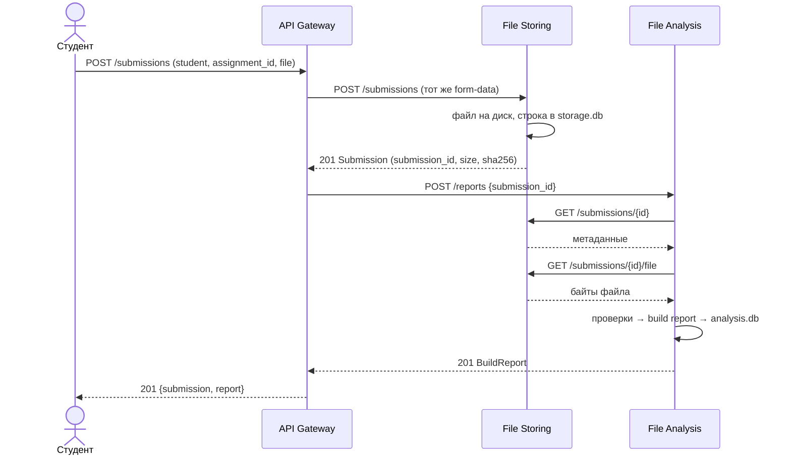
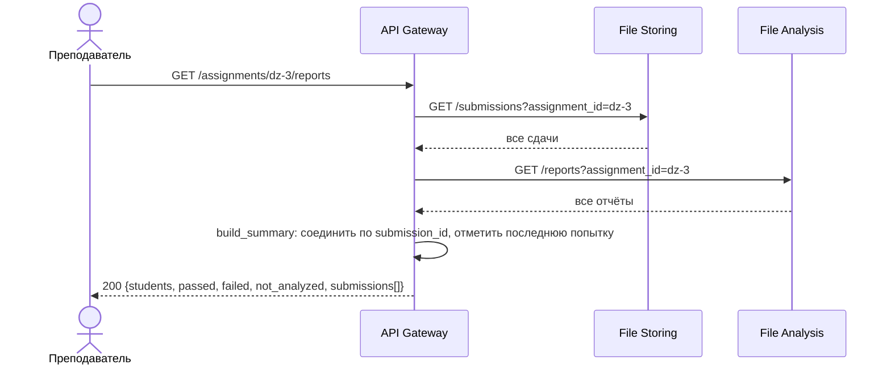

# ВышBuild — проверка сдач домашних работ «на сборку»

> «Если зелёное — можно спать». КПО, домашнее задание №3: синхронное межсервисное взаимодействие.

Серверная часть учебного «CI-лайт»: студент загружает работу, система сохраняет файл, сразу проверяет, похожа ли работа на собираемый проект, и сохраняет build report. Преподаватель смотрит сводку по заданию: у кого билд зелёный, у кого красный, у кого архив из одного README.

**Стек:** Python 3.12 · [FastAPI](https://fastapi.tiangolo.com/) (REST и Swagger) · `httpx` (синхронные HTTP-вызовы между сервисами) · SQLite (своя база у каждого сервиса) · Jinja2 (HTML-карточки) · Docker Compose · `pytest` + `pytest-cov` · `ruff`.

**Итог проверки:** 69 тестов, покрытие **100%** (строки и ветви), `ruff check` без замечаний. `docker compose up` поднимает все три сервиса. Сценарии сдачи и отказа отдельных сервисов проверены на живых контейнерах. Postman-коллекция проходит целиком.

---

## Содержание

1. [Запуск](#1-запуск)
2. [Что умеет: требования → код](#2-что-умеет-требования--код)
3. [Архитектура](#3-архитектура)
4. [API](#4-api)
5. [Сценарии обмена между сервисами](#5-сценарии-обмена-между-сервисами)
6. [Алгоритм «проверки на сборку»](#6-алгоритм-проверки-на-сборку)
7. [Обработка сбоев](#7-обработка-сбоев)
8. [Обязательные вопросы](#8-обязательные-вопросы)
9. [Тесты](#9-тесты)
10. [Чего сознательно нет](#10-чего-сознательно-нет)
11. [Роль ИИ](#11-роль-ии)

---

## 1. Запуск

```bash
cd SD3
docker compose up --build
```

| Адрес | Что там |
|---|---|
| http://localhost:8000/docs | **Swagger API Gateway**: единственная точка входа для клиентов |
| http://localhost:8000/assignments/dz-3/dashboard | сводка по заданию в виде HTML-страницы |
| http://localhost:8000/submissions/{id}/card | карточка билда одной сдачи |

Наружу открыт только порт gateway: клиент не может обойти сценарий и, например, сохранить сдачу в хранилище без анализа. Чтобы показать Swagger внутренних сервисов (http://localhost:8001/docs и http://localhost:8002/docs), запустите с отладочным файлом:

```bash
docker compose -f docker-compose.yml -f docker-compose.debug.yml up --build
```

**Postman.** Импортируйте [`postman/VyshBuild.postman_collection.json`](postman/VyshBuild.postman_collection.json) и запустите папки по порядку (Runner). Файлы для загрузки лежат в [`samples/`](samples), поэтому рабочей папкой Postman должна быть `SD3` (Settings → Working directory). Из консоли: `newman run postman/VyshBuild.postman_collection.json --working-dir .`. У каждого запроса есть тесты: код ответа, статус билда, учёт последней попытки. Первый запрос создаёт новое задание `dz-3-<время>`, поэтому коллекцию можно запускать повторно на тех же данных.

**Быстрая проверка из консоли:**

```bash
curl -F student="Иванов Иван" -F assignment_id=dz-3 -F file=@samples/good-python.zip localhost:8000/submissions
curl localhost:8000/assignments/dz-3/reports
```

**Посмотреть отказ сервиса:**

```bash
docker compose stop analysis     # сдача сохраняется, ответ 202 и причина
docker compose stop storage      # сдача не принимается, ответ 503 и причина
docker compose start storage analysis
```

**Тесты и стиль без Docker:**

```bash
python3 -m venv .venv && source .venv/bin/activate
pip install -e ".[dev]"
pytest --cov
ruff check . && ruff format --check .
```

## 2. Что умеет: требования → код

| # | Требование ТЗ | Где в коде |
|---|---|---|
| 1 | Приём сдачи: студент, задание, файл | [`POST /submissions` в gateway](gateway/gateway/app.py) |
| 2 | Сохранение артефакта и учёт сдачи | [`SubmissionRepository`](storage/storage_service/repository.py): метаданные в SQLite, файл на диске |
| 3 | Синхронный запуск анализа и сохранение build report | gateway → [`POST /reports`](analysis/analysis_service/app.py) → [`Analyzer`](analysis/analysis_service/analyzer.py) → [`ReportRepository`](analysis/analysis_service/repository.py) |
| 4 | Отчёты и сводка по заданию | `GET /submissions/{id}`, `GET /assignments/{id}/reports`: [`build_summary`](gateway/gateway/summary.py) |
| 5 | Postman и Swagger | [коллекция](postman/VyshBuild.postman_collection.json), `/docs` у каждого сервиса |
| 6 | Внятная ошибка при падении сервиса | [`ServiceClient.request`](gateway/gateway/clients.py), раздел [7](#7-обработка-сбоев) |
| ★ | Повторная сдача, в сводке учитывается последняя попытка | [`build_summary`](gateway/gateway/summary.py), поле `is_latest` |
| ★ | Разные правила под разные языки | точки входа для Python, Java, Kotlin, C#, C, C++, Go, Rust; компиляция Python ([`checks.py`](analysis/analysis_service/checks.py)) |
| ★ | Визуализация отчёта | [HTML-сводка и карточка билда](gateway/gateway/templates) |
| ★ | Перезапуск анализа после сбоя | `POST /submissions/{id}/analyze` |

## 3. Архитектура



### Кто за что отвечает

| Сервис | Отвечает за | Хранит | Не знает о |
|---|---|---|---|
| **API Gateway** | единая точка входа; сценарий «сохранить → проверить»; перевод сбоев в понятные ответы; сводка по заданию (соединяет сдачи и отчёты); HTML-визуализация | ничего, сервис без состояния | SQLite, файлах, правилах проверки |
| **File Storing Service** | приём, хранение и выдача сдач и их файлов | сдача: кто, когда, задание, имя файла, размер, sha256; сам файл | анализе и отчётах |
| **File Analysis Service** | проверка «на сборку», хранение и выдача отчётов | build report: статус, флаг успеха, язык, результат каждой проверки | gateway, клиентах |

Общей базы нет: у каждого сервиса свой том в [`docker-compose.yml`](docker-compose.yml). Данные чужого сервиса доступны только через его HTTP API. Общего кода между сервисами тоже нет: каждый собирается в свой образ из своей папки, со своими зависимостями (`requirements.txt`). Контракт gateway описан отдельно в [`schemas.py`](gateway/gateway/schemas.py).

### Структура

```
SD3/
├── storage/                File Storing Service (:8001)
│   ├── storage_service/    app.py (API) · repository.py (SQLite + файлы) · settings.py
│   ├── Dockerfile · requirements.txt
├── analysis/               File Analysis Service (:8002)
│   ├── analysis_service/   app.py · storage_client.py · project.py (чтение архива)
│   │                       checks.py (проверки) · analyzer.py (прогон) · repository.py
│   ├── Dockerfile · requirements.txt
├── gateway/                API Gateway (:8000)
│   ├── gateway/            app.py · clients.py (HTTP-клиенты, сбои) · summary.py · schemas.py
│   │   └── templates/      сводка, карточка билда, страница ошибки
│   ├── Dockerfile · requirements.txt
├── docker-compose.yml        все сервисы, наружу только :8000
├── docker-compose.debug.yml  открыть :8001 и :8002 для демонстрации Swagger
├── postman/                Postman-коллекция
├── samples/                примеры сдач: зелёная, пустая, с ошибкой синтаксиса, только README, Java
└── tests/                  тесты всех сервисов и сквозных сценариев
```

Внутри каждого сервиса одна и та же схема: `create_app(settings, …)` — единственное место, где собираются зависимости (composition root, как `Container` в ДЗ-1). HTTP-клиент к соседнему сервису передаётся в `create_app` параметром. Так тесты подменяют сеть, не меняя код сервиса (раздел [9](#9-тесты)).

## 4. API

**Публичное (API Gateway, :8000):**

| Метод и путь | Кто | Что делает | Ответы |
|---|---|---|---|
| `POST /submissions` (form-data: `student`, `assignment_id`, `file`) | студент | сохранить и сразу проверить | 201: сдача и отчёт · 202: сдача сохранена, отчёта нет · 411/413/422: неверный запрос · 503/504: хранилище недоступно |
| `GET /submissions/{id}` | оба | сдача и её отчёт | 200 · 404 |
| `POST /submissions/{id}/analyze` | оба | перезапустить анализ | 201 · 404 · 503 |
| `GET /submissions/{id}/file` | преподаватель | скачать сданный файл | 200 · 404 |
| `GET /assignments/{id}/reports` | преподаватель | сводка: статусы всех сдач и счётчики | 200 · 503 |
| `GET /assignments/{id}/dashboard` | преподаватель | та же сводка в HTML | 200 · 503 (HTML) |
| `GET /submissions/{id}/card` | оба | карточка билда в HTML | 200 · 404 |
| `GET /health` | — | состояние gateway и обоих сервисов | 200 |

**Внутреннее** (снаружи недоступно, открывается через `docker-compose.debug.yml`):

| Сервис | Метод и путь |
|---|---|
| Storing | `POST /submissions` · `GET /submissions?assignment_id=` · `GET /submissions/{id}` · `GET /submissions/{id}/file` · `GET /health` |
| Analysis | `POST /reports` (`{"submission_id"}`) · `GET /reports?assignment_id=` · `GET /reports/{submission_id}` · `GET /health` |

Пример ответа на сдачу (сокращён):

```json
{
  "submission": {"submission_id": "965dd2…", "student": "Сидорова Анна", "assignment_id": "dz-3",
                 "filename": "syntax-error.zip", "size_bytes": 431, "sha256": "c00824…"},
  "report": {"status": "FAILED", "success": false, "language": "Python",
             "checks": [{"name": "python_syntax", "title": "Python компилируется", "status": "failed",
                         "message": "hw/main.py, строка 1: invalid syntax"}, "…"]},
  "analysis_error": null
}
```

## 5. Сценарии обмена между сервисами

### Сдача работы (end-to-end)



Все вызовы синхронные: каждый участник ждёт HTTP-ответа, прежде чем идти дальше. Студент получает отчёт в ответе на свою загрузку.

**Почему аналитика сама берёт файл у хранилища, а не получает его от gateway.** Источник правды о файле один, File Storing Service. Gateway передаёт только идентификатор и не гоняет файл второй раз. Поэтому перезапуск анализа (`POST /submissions/{id}/analyze`) работает без повторной загрузки: аналитика возьмёт тот же файл.

### Сводка для преподавателя



Сдачи берутся у хранилища, а не только у аналитики. Иначе сдача, которую не успели проверить (аналитика лежала), выпала бы из сводки. Сейчас она видна как «нет отчёта» (`not_analyzed`). Счётчики считаются по **последней** попытке каждого студента, старые попытки остаются в списке с `is_latest: false`.

## 6. Алгоритм «проверки на сборку»

Код студента никогда не запускается: это небезопасно и не нужно по ТЗ. Единственная настоящая компиляция — разбор Python в байт-код через `compile()` без выполнения (проверка 6). Сдача (один файл или `.zip`) читается в память, без распаковки на диск, и проходит цепочку проверок из [`checks.py`](analysis/analysis_service/checks.py):

| # | Проверка | Провал, если | Итог при провале |
|---|---|---|---|
| 1 | Файл не пустой | 0 байт | **FAILED**, остальные пропускаются |
| 2 | Содержимое читается | `.zip` повреждён, защищён паролем или сжат неподдерживаемым методом; больше 2000 файлов или больше 50 МБ после распаковки (защита от zip-бомб) | **FAILED**, остальные пропускаются |
| 3 | Есть исходный код | нет ни одного файла `.py .java .kt .cs .c .cpp .go .rs .js .ts` (`.venv`, `node_modules`, `__pycache__`, `build` не считаются) | **FAILED**, остальные пропускаются |
| 4 | Есть файл сборки | нет `pyproject.toml`, `requirements.txt`, `pom.xml`, `build.gradle`, `*.csproj`, `CMakeLists.txt`, `Makefile`, `package.json`, `go.mod`, `Cargo.toml`… | warning |
| 5 | Есть точка входа | для основного языка нет `main`: для Python — `if __name__ == "__main__"` или файл `__main__.py` / `main.py` / `app.py` (скрипт запускается и без «гарда»); `static void main`, `fun main`, `static … Main(`, `int main(`, `func main()`, `fn main()` | **FAILED** |
| 6 | Python компилируется | любой `.py` не проходит `compile()` (синтаксическая ошибка с файлом и строкой) | **FAILED** |
| 7 | Есть README | README нет | warning |

Основной язык — тот, на котором больше всего файлов. Для языка без правила (JavaScript, TypeScript) проверка точки входа пропускается (`skipped`), а не проваливается. Отчёт успешен (`SUCCESS`, `success: true`), если ни одна проверка не провалилась. Предупреждения на итог не влияют.

**Почему такой алгоритм.** Он ловит ровно те случаи, о которых говорит заказчик: пустой файл, «архив из одного README», «не собирается». Кроме того, для Python это почти настоящая сборка. `compile()` переводит код в байт-код без выполнения, поэтому синтаксические ошибки ловятся безопасно и быстро. Для других языков проверяется структура (файл сборки, `main`), полноценный компилятор каждого языка в образе — это уже песочница-бонус. Проверки 1–3 блокирующие: если файл пустой, сообщать «нет README» и «нет main» — шум.

**Как добавить новую проверку.** Пишем функцию `Project -> (статус, сообщение)` и добавляем одну строку в `DEFAULT_CHECKS`. `Analyzer`, API, хранилище отчётов и HTML не меняются. Тест [`test_new_check_is_added_without_changing_analyzer`](tests/analysis/test_checks.py) показывает это на проверке «нет секретов в `.env`».

## 7. Обработка сбоев

Все вызовы соседних сервисов идут через [`ServiceClient`](gateway/gateway/clients.py) с таймаутом (10 с в gateway, 5 с в аналитике). Метод `request` превращает сетевой сбой или код ошибки в `UpstreamError`, а `parse` делает то же с ответом не по контракту (не JSON, не та схема): это тоже 502, а не 500 у самого gateway. Ошибки самого gateway (неверный формат id, нет файла в форме) имеют тот же вид, только `service: "API Gateway"`. Клиент получает JSON или HTML-страницу, если запрос пришёл из браузера:

```json
{"error": "service_unavailable", "service": "File Storing Service",
 "message": "File Storing Service недоступен, повторите запрос позже"}
```

| Что случилось | Клиент получает |
|---|---|
| сервис не отвечает на соединение (контейнер остановлен) | **503** `service_unavailable` |
| сервис не ответил за таймаут | **504** `service_timeout` |
| сервис ответил 5xx или ответ не по контракту | **502** `service_error`, текст ошибки сервиса |
| ошибка клиента: нет сдачи (404), пустое имя студента (422) | тот же код и понятный текст |
| неверный формат id сдачи или задания, нет файла в форме | **422** от gateway, до обращения к сервисам |
| тело запроса больше 20 МБ / нет `Content-Length` | **413** / **411** от gateway, **до** разбора multipart: большой файл не пишется даже во временный файл |

Обработка на каждом шаге сценария сдачи:

| Сбой | Что происходит | Ответ |
|---|---|---|
| **Storing недоступен** при сдаче | ничего не сохранено, анализ не вызывается | **503**: «File Storing Service недоступен, повторите запрос позже» |
| **Analysis недоступен** при сдаче | работа **уже сохранена**, отчёта нет | **202** `{submission, report: null, analysis_error}`; отчёт можно получить позже через `POST /submissions/{id}/analyze` |
| Storing упал **между** сохранением и анализом | аналитика не может взять файл и отвечает 503 | **202**: `service` — кто ответил ошибкой (File Analysis Service), `message` — в чём причина («File Storing Service недоступен») |
| таймаут Storing при сдаче | исход неизвестен: хранилище могло успеть сохранить файл | **504**; прежде чем сдавать снова, стоит проверить сводку по заданию, иначе возможна лишняя попытка (в счётчиках всё равно учитывается последняя) |
| Analysis недоступен при просмотре сдачи | сдача показывается без отчёта | **200** с `analysis_error` |
| любой из двух недоступен при запросе сводки | неполную сводку не показываем: «0 провалов» при лежащей аналитике ввёл бы в заблуждение | **503** с именем сервиса |
| `GET /health` | показывает, кто именно лежит | `{"gateway": "ok", "storage": "ok", "analysis": "unavailable"}` |

Почему 202, а не 503, если лежит аналитика: работа студента принята и не потеряна, дедлайн соблюдён. Ответ 503 заставил бы студента загружать её снова и создал бы дубль. Код 202 Accepted означает: «принято, обработка не завершена».

В `docker-compose.yml` у каждого сервиса есть `healthcheck`, а gateway стартует только после того, как хранилище и аналитика стали `healthy` (`depends_on: condition: service_healthy`). Упавший процесс перезапускается (`restart: unless-stopped`).

## 8. Обязательные вопросы

### Как разрезаны ответственности Store / Analyze / Gateway?

См. таблицу в разделе [3](#кто-за-что-отвечает). Коротко: **Store** хранит сдачи и файлы и ничего о них не думает. **Analyze** проверяет и хранит отчёты, а файл берёт у Store по id. **Gateway** — точка входа без состояния: оркестрирует сдачу, собирает сводку из двух сервисов и переводит сбои в понятные ответы.

Учёт сдачи (кто, когда, задание) лежит в Store, а не в отдельном сервисе: сдача — это и есть метаданные артефакта, они создаются и читаются вместе с файлом. Отдельный «Submission Service» с одной таблицей был бы «микросервисом ради галочки». В отчёте аналитики есть копия студента и задания: так аналитика сама отвечает на «все отчёты по заданию», не спрашивая хранилище на каждый отчёт.

### Какой сценарий сдачи end-to-end?

1. Клиент → Gateway: `POST /submissions` (студент, задание, файл).
2. Gateway → Store: `POST /submissions`. Store пишет файл на диск и строку в `storage.db`, возвращает `submission_id`.
3. Gateway → Analysis: `POST /reports {submission_id}`.
4. Analysis → Store: `GET /submissions/{id}` и `GET /submissions/{id}/file`.
5. Analysis прогоняет проверки, сохраняет отчёт в `analysis.db` и возвращает его.
6. Gateway → клиент: `201 {submission, report}`.

Диаграмма — в разделе [5](#сдача-работы-end-to-end).

### Что происходит, если Store или Analyze недоступен?

- **Store недоступен:** 503 с текстом «File Storing Service недоступен…», ничего не сохранено, повторить загрузку позже.
- **Analyze недоступен:** работа сохранена, ответ 202 с причиной, отчёт получаем позже через `POST /submissions/{id}/analyze`.
- Таймауты дают 504, внутренние ошибки сервиса дают 502, «вечного 500 без текста» нет.

Подробности — в разделе [7](#7-обработка-сбоев), тесты — в [`tests/gateway/test_failures.py`](tests/gateway/test_failures.py).

### Какой алгоритм «сборки» выбрали и почему?

Семь эвристических проверок: не пустой, читается, есть код, есть файл сборки, есть точка входа, Python компилируется, есть README. Для Python есть настоящая компиляция через `compile()`, безопасная, потому что код не выполняется. Подробно — в разделе [6](#6-алгоритм-проверки-на-сборку).

### Что сделал ИИ, а что изменили вы?

См. раздел [11. Роль ИИ](#11-роль-ии).

### Что меняется при доработке

| Доработка | Что меняем | Что НЕ меняется |
|---|---|---|
| Повторная сдача | уже есть: каждая загрузка — новая сдача, в сводке учитывается последняя | — |
| «Лучшая» попытка вместо последней | одно правило в [`build_summary`](gateway/gateway/summary.py) | сервисы, API |
| Новый тип проверки | функция и строка в `DEFAULT_CHECKS` ([`checks.py`](analysis/analysis_service/checks.py)) | Analyzer, API, хранилище, gateway |
| Свои правила под задание (например, для ДЗ-1 обязателен `pyproject.toml`) | `Analyzer` выбирает набор проверок по `assignment_id` (у него уже есть `SubmissionInfo`) | Store, gateway |
| Хранение файлов в S3 | `SubmissionRepository` пишет в S3 вместо диска | API хранилища, аналитика, gateway |
| Настоящая сборка в Docker-песочнице | ещё одна проверка, которая запускает компилятор в отдельном контейнере | остальные проверки, API |

## 9. Тесты

```bash
pytest --cov
```

Тесты поднимают **все три сервиса в одном процессе**. FastAPI `TestClient` — это тоже `httpx.Client`, поэтому его передают в `create_app` вместо сетевого клиента. Код сервисов не знает, что работает в тесте ([`conftest.py`](tests/conftest.py)):

```python
storage = TestClient(create_storage(...))
analysis = TestClient(create_analysis(..., storage_http=storage))
gateway = TestClient(create_gateway(..., storage, analysis))
```

«Упавший сервис» — это `httpx.Client` с `MockTransport`, который на каждый запрос бросает `ConnectError` или `ReadTimeout` ([`helpers.unreachable`](tests/helpers.py)). Один тест ходит на закрытый порт по-настоящему.

| Файл | Что фиксирует |
|---|---|
| `analysis/test_checks.py` | алгоритм: зелёный проект, пустой файл, только README, битый zip, синтаксическая ошибка со строкой, нет `main`, другие языки, предупреждения не валят билд, новая проверка без правки анализатора |
| `analysis/test_project.py` | чтение сдачи: один файл, zip без мусора `__MACOSX`, архив с паролем и неизвестным сжатием, защита от zip-бомб, не-UTF-8 |
| `analysis/test_analysis_api.py` | анализ берёт данные у хранилища, повторный анализ заменяет отчёт, 404/502/503/504 со стороны хранилища |
| `storage/test_storage_api.py` | файл отдаётся байт в байт, sha256, пустой файл принимается, лимит 413, 422, данные переживают перезапуск |
| `gateway/test_flow.py` | сквозной сценарий, сводка по последней попытке, перезапуск анализа, скачивание, HTML-сводка и карточка, 422/411/413 от gateway, Swagger |
| `gateway/test_failures.py` | каждый сбой из раздела 7: 503, 202 с последующим восстановлением, 504, 502, ответ не по контракту, HTML-ошибка для браузера, `/health` |
| `test_settings.py` | настройки из переменных окружения, gateway с настоящими HTTP-клиентами |

Тесты проверяют **поведение через HTTP API** (что сохранилось, что вернулось клиенту), а не внутренние вызовы.

## 10. Чего сознательно нет

Цель — понятная схема без лишних деталей. Поэтому **не** делали:

- **очереди и асинхронный обмен:** ДЗ про синхронное взаимодействие, анализ занимает миллисекунды;
- **отдельный Submission Service:** учёт сдачи живёт рядом с файлом (раздел 8);
- **общую библиотеку моделей:** у gateway своя копия контракта, иначе сервисы связаны общим кодом и не собираются независимо;
- **Postgres и S3:** SQLite и диск в своём томе дают то же разделение данных; замена описана в разделе 8;
- **retry и circuit breaker:** при сбое клиент сразу получает понятный ответ, а повтор под его контролем (`/analyze`). Автоматические повторы удлинили бы синхронный ответ;
- **авторизацию ролей:** ТЗ разрешает MVP без неё;
- **DI-контейнер:** зависимостей в каждом сервисе две-три, их собирает `create_app`;
- **ключ идемпотентности для сдачи:** защищает от лишней попытки при таймауте хранилища (раздел 7). Каждая сдача — это и так отдельная попытка, а в сводке учитывается последняя, поэтому дубль ничего не ломает;
- **файл как BLOB в одной транзакции с метаданными:** файл пишется раньше строки в БД. При сбое между ними остаётся лишний файл на томе, но не запись без файла. Для MVP этого достаточно.

## 11. Роль ИИ

**Как использовался ИИ** (ассистент Claude):

- работал как ассистент при написании кода по согласованной архитектуре: предлагал реализацию эндпоинтов, HTTP-клиентов, проверок и шаблонов, варианты тестов;
- помогал с проверками: прогон тестов и покрытия, `ruff`, запуск `docker compose up` и ручные сценарии отказа сервисов;
- провёл независимое ревью вторым ИИ (Codex): по его замечаниям исправлены падение на архивах с паролем, 500 при ответе не по контракту, формат id в URL, лимит размера до разбора multipart, закрытые внутренние порты, healthcheck gateway, эвристика Python и повторяемость Postman. Ключ идемпотентности и BLOB-хранение я сознательно не стал делать (раздел 10);
- помогал оформить README, диаграммы и Postman-коллекцию.

**Что решил и сделал я:**

- выбрал стек (Python, FastAPI, `httpx`, SQLite, Docker Compose) и тот же подход к качеству, что в ДЗ-1: тесты поведения, `ruff`, README с обоснованием решений;
- архитектуру обсуждали и согласовывали до начала реализации, итоговые решения за мной:
  - нарезка на три сервиса по ТЗ; учёт сдачи — в File Storing Service, без отдельного сервиса;
  - аналитика сама берёт файл у хранилища по id; один отчёт на сдачу, повторный анализ его перезаписывает;
  - gateway без состояния; сводка соединяет сдачи и отчёты, чтобы непроверенные сдачи не пропадали;
  - поведение при сбоях: 503, если не сохранили; 202, если сохранили без отчёта; 504 и 502 для таймаута и внутренней ошибки;
  - алгоритм проверки: блокирующие проверки 1–3, предупреждения не валят билд, компиляция Python через `compile()`;
  - сознательные упрощения из раздела 10;
- проверил работу вручную: Swagger, Postman, HTML-сводку и карточку, остановку `storage` и `analysis` через `docker compose stop`;
- разобрал сценарии обмена и ответы на обязательные вопросы (раздел 8).
